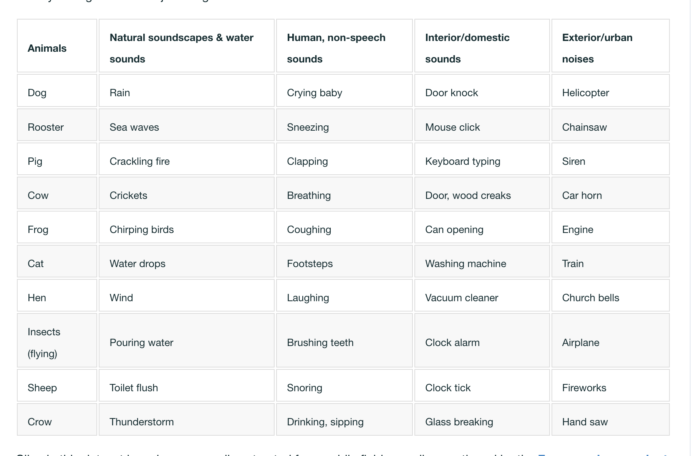

# SOUND DATASETS

## UrbanSound8K

found under data\audio_data\sounds

This dataset contains 8732 labeled sound excerpts (<=4s) of urban sounds from 10 classes: 
1. air_conditioner, 
2. car_horn, 
3. children_playing, 
4. dog_bark,
5.  drilling, 
6. enginge_idling, 
7. gun_shot, 
8. jackhammer, 
9. siren
10. street_music

## Environmental Sound Classification 50

These is really important because it has human non speech sounds which is what we would need for respiratory issues and sleep patterns

