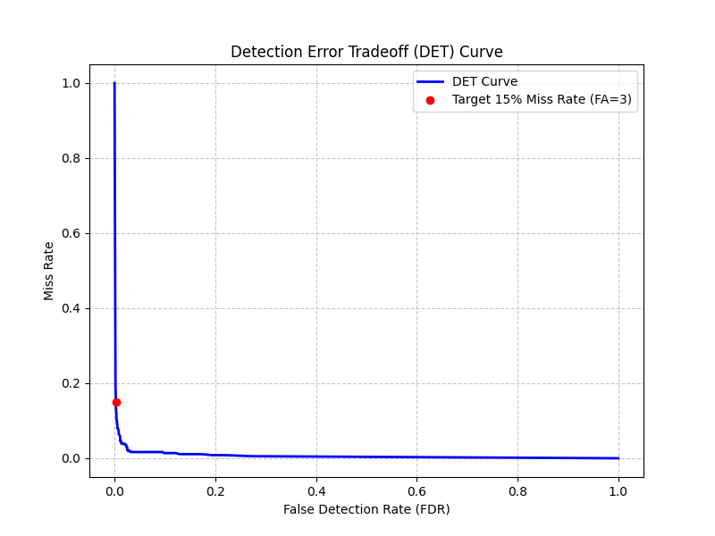

# DET curve

This is a Detection Error Tradeoff (DET) curve, which is the gold standard for evaluating binary classification systems like your wakeword detector.

It visualizes the fundamental tradeoff between the two types of errors your model can make depending on how strictly you set its decision threshold.

Here is a breakdown of how to read it:

1. The Axes (The Two Types of Errors)

Y-Axis (Miss Rate): Also known as the False Reject Rate (FRR) or False Negative Rate. This is the percentage of times the user actually said the wakeword, but the model failed to detect it. A high miss rate means the user has to repeat themselves a lot.

X-Axis (False Detection Rate - FDR): Also known as the False Accept Rate (FAR) or False Positive Rate. This is the percentage of times the model triggered by mistake when the wakeword was not spoken. A high FDR means the device goes off randomly while people are just talking in the background.

2. The Blue Line (The Tradeoff)

The blue line represents every possible decision threshold you could set for your model (from 0.0 to 1.0).

Top Left (Strict): If you require the model to be 99% confident to trigger, your False Detections will be near 0 (it never triggers accidentally), but your Miss Rate will skyrocket (it ignores actual wakewords).

Bottom Right (Sensitive): If you let the model trigger at 5% confidence, your Miss Rate will be near 0 (it catches every real wakeword), but your False Detections will soar (it triggers on every noise).

The Ideal Model: The closer the blue curve bows inward toward the bottom-left corner (0, 0), the better the model is overall. An ideal model would have 0% Miss Rate and 0% False Detections.

3. The Red Dot (Your Chosen Operating Point)

The red dot represents a specific, practical choice you made when evaluating the model.

"Target 15% Miss Rate": You anchored your evaluation by deciding, "I am willing to accept that the model misses the wakeword 15% of the time." (Y-axis = 0.15).

"FA = 3": The graph tells you that to achieve that 15%f miss rate, you have to lower the threshold enough that the model makes 3 False Accepts across your entire test dataset.

If you look straight down from the red dot to the X-axis, it lands at roughly 0.05 (or 5%). This means that at your chosen threshold, the model incorrectly flags about 5% of all the negative background audio clips as the wakeword.

Summary of your model's performance based on this graph:
To get the model to catch 85% of real wakewords (a 15% miss rate), you have to accept a 5% false alarm rate (3 false alarms in your test set). If you decide 3 false alarms is too annoying for the user, you will have to move your threshold up the blue line, meaning the model will have fewer false alarms, but it will miss the wakeword more often.